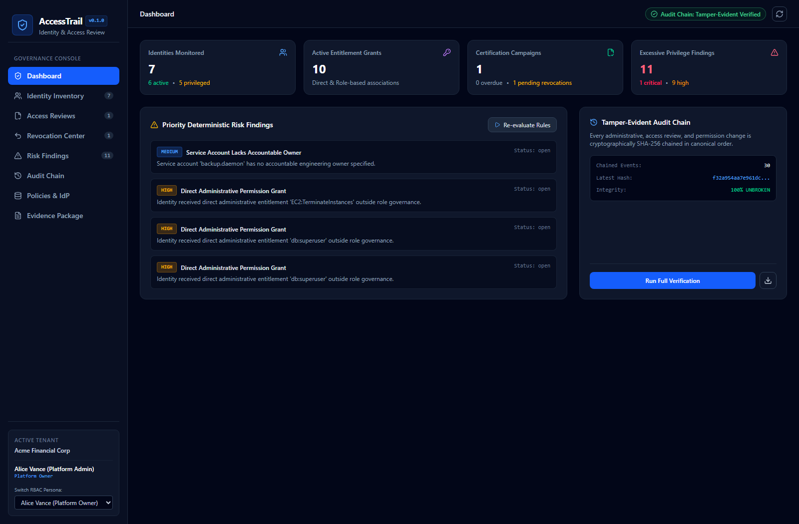
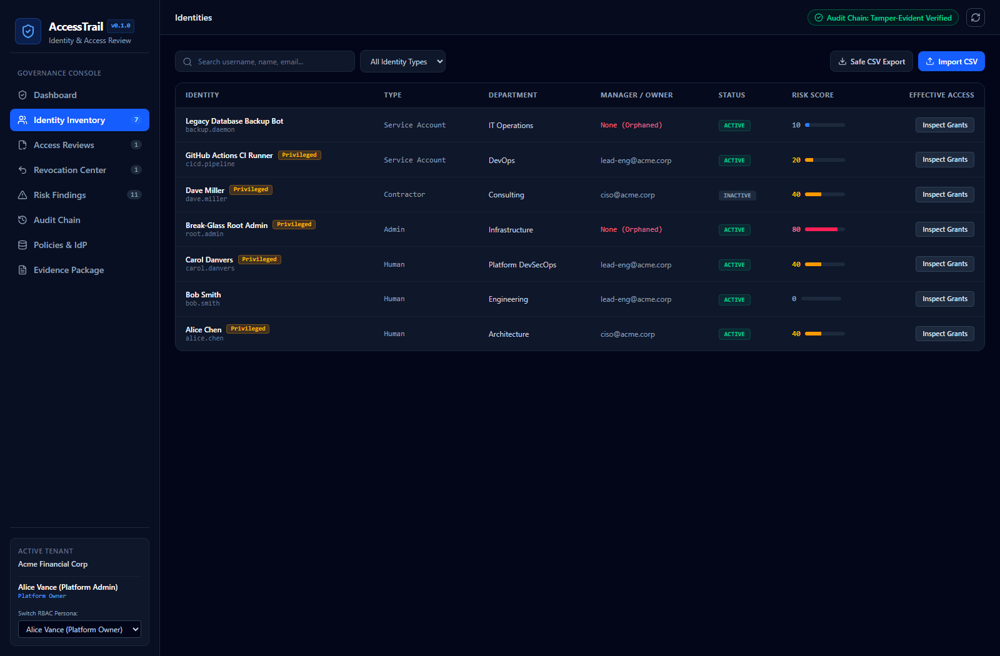
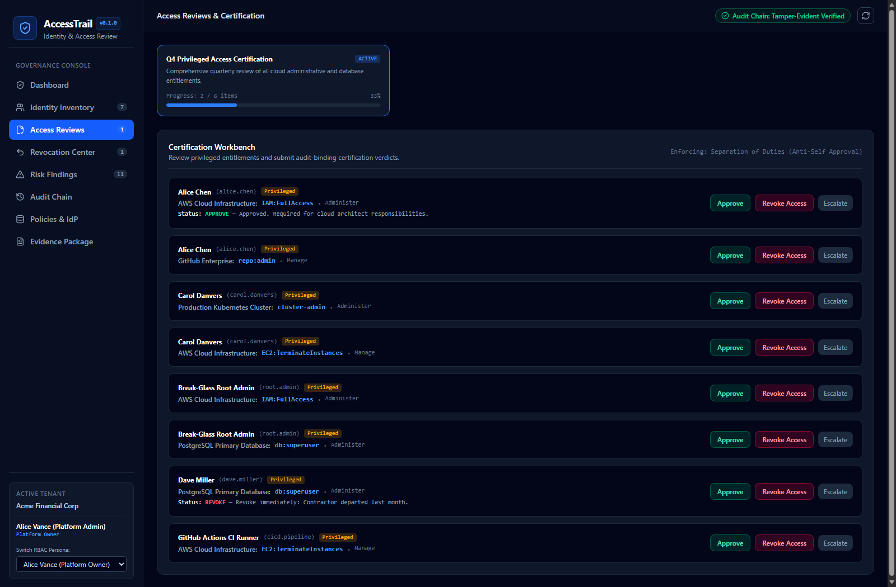
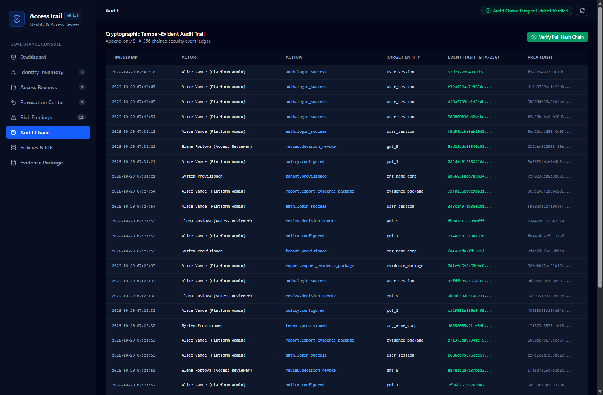

# AccessTrail

> **Identity, Access Review & Permission Audit Platform**  
> Centralized identity governance, periodic access reviews, least-privilege enforcement, excessive privilege detection, and cryptographic tamper-evident audit trails.

[](LICENSE)
[](https://www.python.org/)
[](https://fastapi.tiangolo.com/)
[](https://react.dev/)
[](https://tailwindcss.com/)
[](tests/)

---

## Platform Screenshots

### Security Operations Dashboard


### Centralized Identity Inventory & Effective Access Inspection


### Certification Workbench & Separation of Duties (Anti-Self Approval)


### Cryptographic Tamper-Evident SHA-256 Audit Trail


---

## Repository Details

- **GitHub Repository**: [https://github.com/0xyz-exe/access-trail](https://github.com/0xyz-exe/access-trail)
- **Maintainer**: `0xyz-exe` (danielachmadf@gmail.com)
- **License**: MIT
- **Architecture**: Single-tenant / Multi-tenant modular monolith (FastAPI backend + Vite React SPA)

---

## Key Capabilities

1. **Centralized Identity Inventory**
   - Tracks humans, administrators, service accounts, applications, and contractors.
   - Real-time status, department, and accountable manager/owner mapping.
   - Safe CSV export with spreadsheet formula injection protection (`=, +, -, @, \t, \r` escaping).
   - Validated CSV import parser.

2. **Entitlement & Permission Registry**
   - Normalized permission modeling across Applications, Resources, System Roles, and Entitlements.
   - Explicit distinction between **Direct Grants** and **Inherited Role** provenance.
   - Granular justification, approval references, and expiration tracking.

3. **Access Certification & Review Campaigns**
   - Scoped campaign creation (all entitlements, privileged accounts only, or target systems).
   - Certification workbench supporting `Approve`, `Revoke`, `Escalate`, and `Request Info` decisions.
   - **Enforced Separation of Duties (Anti-Self-Approval)**: Server strictly rejects reviewers attempting to certify their own access (`HTTP 400`).

4. **Revocation State Machine**
   - Lifecycle tracking: `requested` $\to$ `executing` $\to$ `completed` / `failed`.
   - Auto-spawns revocation requests upon reviewer `Revoke` verdicts.
   - Idempotent execution against connectors.

5. **Deterministic Risk Engine**
   - 6 transparent detection rules:
     - Unmanaged Privileged Account (Critical)
     - Inactive Account Retaining Active Permissions (High)
     - Direct Administrative Grant bypassing role governance (High)
     - Overdue Certification Campaign (High)
     - Expired Access Grant still active (Medium)
     - Service Account without accountable owner (Medium)
   - Dynamic identity risk scoring ($0 - 100$).

6. **Cryptographic Tamper-Evident Audit Trail**
   - Append-only event ledger using SHA-256 hash chaining:
     $$\text{EventHash}_i = \text{SHA256}(\text{EventHash}_{i-1} \parallel \text{CanonicalJSON}(P_i))$$
   - Live cryptographic chain verification (`/api/v1/audit-logs/verify` and CLI `verify-audit`).

---

## Quickstart

### 1. Prerequisites
- Python 3.12+ (managed with `uv` or `pip`)
- Node.js 20+

### 2. Local Setup
```bash
# Clone the repository
git clone https://github.com/0xyz-exe/access-trail.git
cd access-trail

# Install dependencies
uv sync
cd frontend && npm install && npm run build && cd ..

# Seed demonstration data
uv run python -m backend.app.cli.main seed-demo

# Launch application
uv run python -m uvicorn backend.app.main:app --port 8000
```
Open [http://localhost:8000](http://localhost:8000) in your browser.

### 3. Docker Compose
```bash
docker compose up -d --build
```

---

## Preconfigured Demonstration Personas

All accounts are pre-seeded with the password: `Password123!`

| Persona | Role | Email |
| :--- | :--- | :--- |
| **Alice Vance** | Platform Owner | `admin@acme.corp` |
| **Marcus Ray** | Security Admin | `secadmin@acme.corp` |
| **Elena Rostova** | Access Reviewer | `reviewer@acme.corp` |
| **David Thorne** | External Auditor | `auditor@acme.corp` |
| **Sophie Lin** | SOC Analyst | `analyst@acme.corp` |

---

## Verification & Testing

Run full backend test suite:
```bash
uv run pytest -v
```

Output:
```
tests/test_api_endpoints.py::test_health_check PASSED
tests/test_api_endpoints.py::test_auth_login PASSED
tests/test_api_endpoints.py::test_csv_formula_sanitization PASSED
tests/test_audit_chain.py::test_audit_hash_chain_integrity PASSED
tests/test_auth_and_rbac.py::test_password_hashing PASSED
tests/test_auth_and_rbac.py::test_tenant_isolation PASSED
tests/test_review_and_revocation.py::test_access_review_workflow_and_sod PASSED
======================== 7 passed in 4.22s =========================
```

Verify cryptographic hash chain via CLI:
```bash
uv run python -m backend.app.cli.main verify-audit
```

---

## Documentation

- [Architecture Overview](docs/architecture.md)
- [Database Schema](docs/database-schema.md)
- [Threat Model](docs/threat-model.md)
- [Certification Workflow](docs/access-review-workflow.md)
- [Deployment Guide](docs/deployment.md)
- [Implementation Progress & Verification](docs/progress.md)
